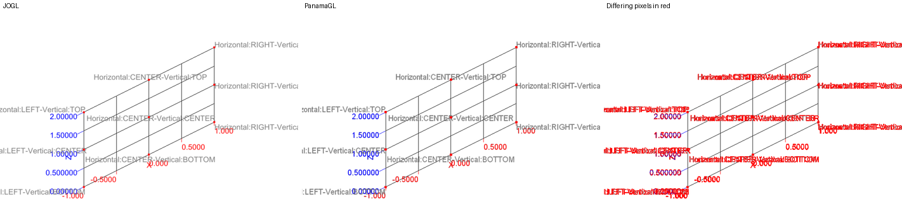
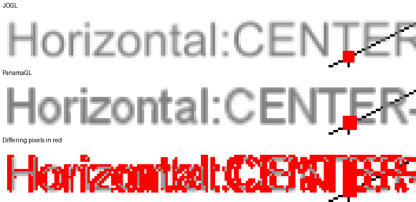
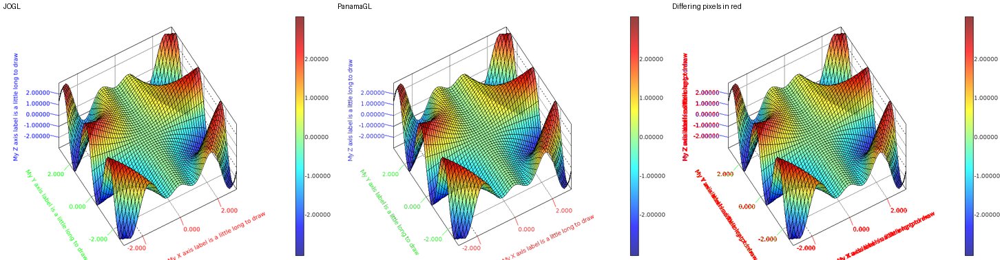

jzy3d-tester-integration
========================

This module holds the integration tests of Jzy3D. They render charts with each toolkit (JOGL with AWT
and Swing, EmulGL, PanamaGL) and verify the screenshots. It requires Java 9+ to detect HiDPI
displays, and Java 22+ to also test PanamaGL (see the `panamagl` profile of this module).

See the `BASELINE_<platform>.md` files to watch the baseline images of a platform, e.g.
[BASELINE_macosx_26.6_AppleM3.md](BASELINE_macosx_26.6_AppleM3.md).

## Run the tests

```
# All integration tests (and unit tests) of the project
mvn clean install -Pintegration-tests

# Integration tests of this module only, once the other modules are installed
mvn verify -Pintegration-tests -pl jzy3d-tester-integration

# A single test
mvn verify -Pintegration-tests -pl jzy3d-tester-integration -Dit.test=ITTest_Surface
```

Tests named `ITTest*` are excluded from the default build. [Some tests](src/test/java/org/jzy3d/tests/manual)
require a manual verification.

## Two kinds of tests

**Tests comparing charts to baseline images** (`ITTest_Surface`, `ITTest_Scatter`, `ITTest_Text`,
`ITTest_Colorbar`, `ITTest_2D*`, `ITTest_Overlay`, `ITTest_AxisLabelRotateLayout`) render each case for each
toolkit and each HiDPI mode, then call `ITTest.assertChart(chart, name)`.

* Baselines are stored per platform in `src/test/resources/<platform>/`, where the platform label is the OS
  name, OS version and GPU name given by `NativePlatform` (e.g. `macosx_26.6_AppleM3`). Rendering differs
  between OS, GPU and drivers, hence a baseline is only valid for its platform.
* A baseline missing for the current platform is built from the chart at the first run, then the test
  passes : **look at new baselines before committing them**, and regenerate the `BASELINE_<platform>.md`
  index (test `ITTest.markdownAllTests`, run with any ITTest).
* JOGL and EmulGL charts must match their baseline exactly. On failure, the actual, expected, diff and
  zoom images are written to `target/error-<name>_*.png`.
* **PanamaGL charts have no baseline.** They are compared to the JOGL baseline of the same case
  (`Native_Swing`, or `Native_AWT`), since both render with the native OpenGL library. Text is rasterized
  slightly differently, hence a tolerance, see [Tolerance of PanamaGL charts](#tolerance-of-panamagl-charts).
  On failure, the actual, expected and diff images are written to `target/error-<name>_*.png`.
* `ITTest_Scatter` does not compare PanamaGL to JOGL : JOGL axis text alters the rendering of the points
  drawn after it (35% of the points pixels differ), which PanamaGL does not.

**Tests comparing PanamaGL to JOGL** (`ITTest_PanamaGLParity`, `ITTest_GPUDrawables`,
`ITTest_DepthPeeling`, `ITTest_Picking`) render the same chart with both toolkits on the same computer and
compare the images with the same tolerance. They need no baseline, hence run anywhere, including CI. On
failure, images are written to `target/panamagl-parity/`.

## Tolerance of PanamaGL charts

A PanamaGL chart is compared pixel by pixel to the JOGL image of the same case
(`ITTest.assertSimilarToJOGL`) :

* a pixel **differs** if one of its red, green or blue channels differs by more than 32 (out of 255,
  `ITTest_PanamaGLParity.PIXEL_TOLERANCE`), which ignores small color variations ;
* the test fails if the ratio of differing pixels exceeds a **threshold** : `ITTest.PANAMAGL_MAX_DIFF_RATIO`
  (2%) by default, `ITTest_Text.PANAMAGL_TEXT_MAX_DIFF_RATIO` (6%) for `ITTest_Text`, whose charts are mostly
  made of text. A test can give its own threshold with `assertChart(chart, name, maxDiffRatio)`.

Geometry (surfaces, lines, points, colorbars) renders the same with JOGL and PanamaGL. Differences come from
**text** : JOGL `TextRenderer` and PanamaGL `OrientedTextRenderer` both draw glyphs with AWT in a texture, but
glyph edges are antialiased differently, and PanamaGL rounds glyph advances to whole pixels while JOGL uses
fractional ones, so that a long label may end a few pixels apart. The ratio of differing pixels hence
depends on the amount of text in the chart and on the OpenGL renderer.

A threshold is a trade off : too low, a test fails for invisible differences ; too high, it misses
regressions on small elements (a missing tick label changes less than 0.1% of the pixels of a 800x600 chart). Thresholds should be
set just above the ratios measured on the platforms where the tests run, and checked again when a platform
is added.

### Example : ratios measured on CI

The table below is an **example**, measured by CI in October 2026 (charts of 800x600 pixels, runners
without HiDPI display). The thresholds were then 1% (2% for `ITTest_Text`), and have been **raised to 2%
(6% for `ITTest_Text`) to let the builds pass** on all CI platforms. Other platforms and renderers give
other ratios.

| Test case                                 | Threshold | Linux x86_64 and ARM64 (Mesa llvmpipe) | macOS ARM and Intel (Apple Software Renderer) | Windows x86_64 (Mesa D3D12) |
|-------------------------------------------|-----------|----------------------------------------|-----------------------------------------------|-----------------------------|
| `ITTest_AxisLabelRotateLayout`            | 2%        | 1.49% to 1.50%                         | 1.44%                                         | 1.61%                       |
| `ITTest_2D_Colorbar` view XZ              | 2%        | 0.67%                                  | 1.14%                                         | 1.03%                       |
| `ITTest_Colorbar` custom font             | 2%        | 0.86%                                  | < 1%                                          | 1.07%                       |
| `ITTest_Text.whenDrawableTextRenderer`    | 6%        | 3.49% to 3.50%                         | < 2%                                          | 5.25%                       |
| Other cases (surface, 2D, overlays, text) | 2% or 6%  | 0.28% to 0.91%                         | < 1%                                          | < 1%                        |

**5% of differing pixels is not much** : on the chart below, the worst case of the table, JOGL and PanamaGL
can not be told apart, and all differing pixels (in red) are on the edges of glyphs.



Zoomed 4 times : glyphs have the same shapes, but PanamaGL places them up to a few pixels apart along the
label.



Rotated axis labels on Linux, 1.5% of differing pixels :



To look at the differences of a failed test, open `target/error-<name>_DIFF.png` : it is the JOGL image
with the differing pixels in red.

## Continuous integration

CI runners (Linux with Mesa llvmpipe, macOS VM, Windows with Mesa D3D12) have no baseline in the repository,
and their platform labels change with runner images. CI hence runs all `ITTest_*` with
`-Djzy3d.ittest.baselines=target/ittest-baselines/` : baselines are built in this empty folder by JOGL and
EmulGL charts, and PanamaGL charts are compared to the JOGL ones built on the same runner. CI thus verifies
PanamaGL against JOGL on each OS, but does not detect regressions of JOGL or EmulGL themselves, which
requires running the tests on a computer having baselines.

CI GPUs are virtual or software renderers : a bug depending on an actual GPU (e.g. depth precision on Apple
Silicon) is only detected on a real computer.

## Known limitations

* **HiDPI** : on a HiDPI display, JOGL and PanamaGL ignore `HiDPI.OFF` and render at the physical
  resolution (e.g. 1600x1144 for a 800x572 chart), while EmulGL honours it.
* **Text** : JOGL draws glyphs from a glyph cache and PanamaGL from AWT images. Both scale fonts with the
  pixel scale of the display, but glyph edges are antialiased differently.
* **Fonts** : a font missing on a platform (e.g. Apple Chancery on Linux) is replaced by another one.

## Weight of baseline images

Baselines make almost all the size of the repository : about 300 MB in the working tree (1100 PNG, mostly
1600x1144 HiDPI images of 200 KB to 700 KB) and 400 MB of the 440 MB of a clone, with their older versions.
Each new platform adds 30 MB to 80 MB. PanamaGL charts have no baselines of their own for this reason : they
are compared to JOGL baselines.

CI checks out the repository without the baselines. See [doc/repository-size.md](../doc/repository-size.md)
to clone without them, and for the plan to make clones lighter (obsolete platforms, separate repository for
baselines or Git LFS, history rewrite).
